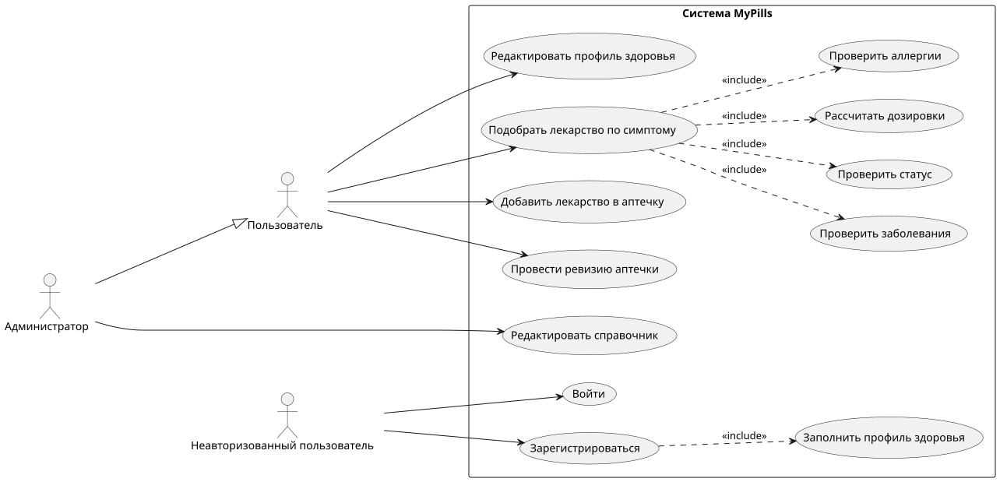
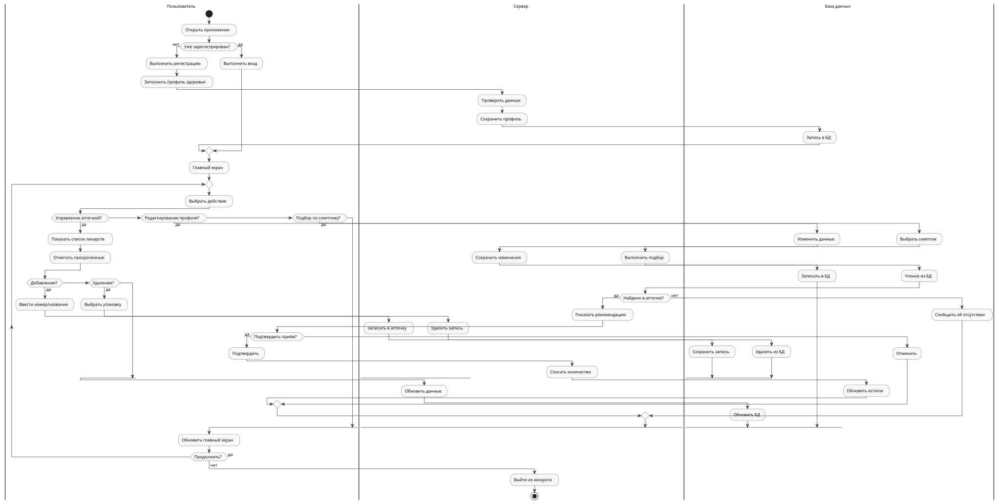
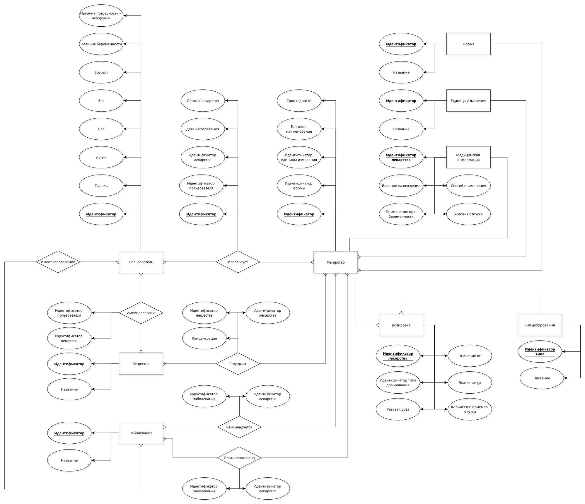
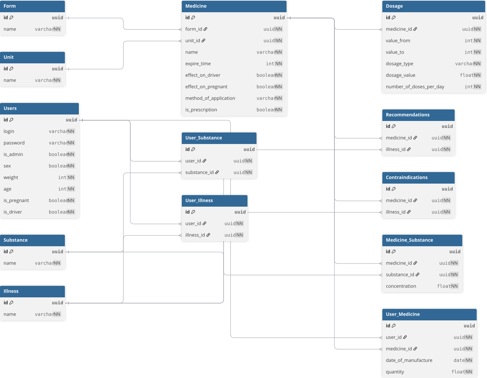
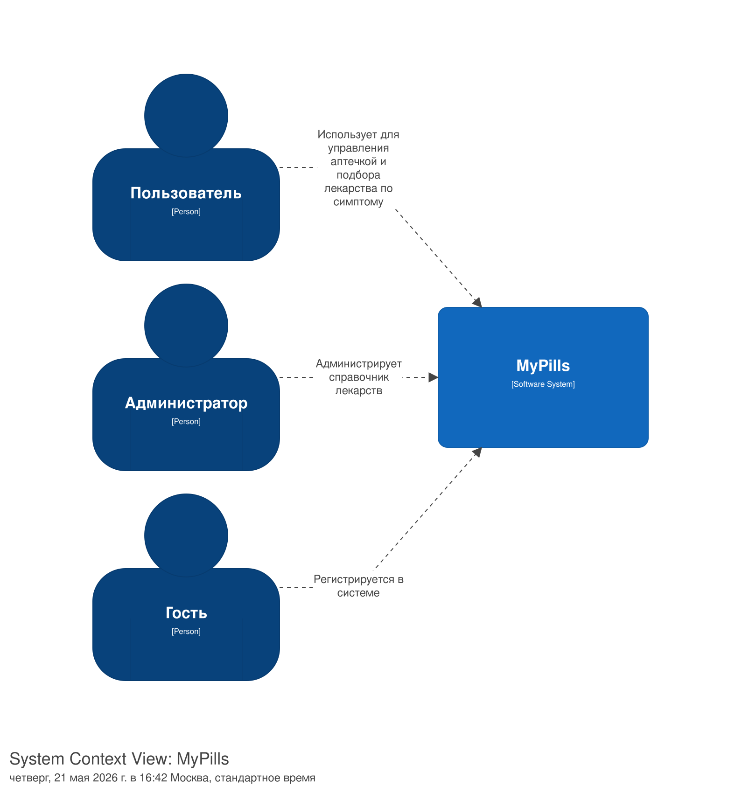
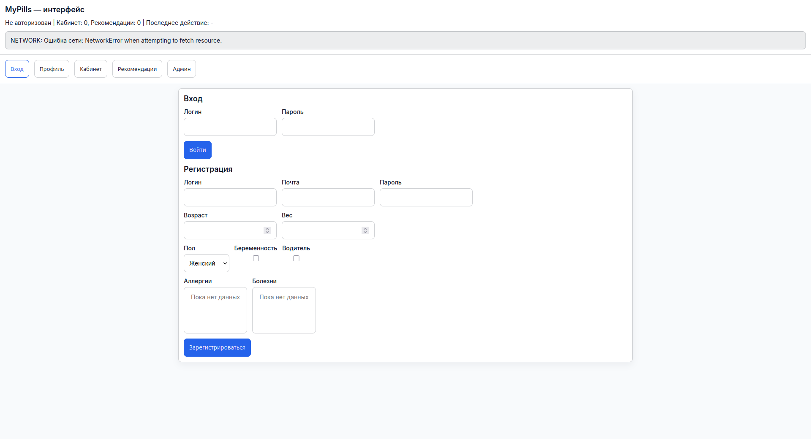
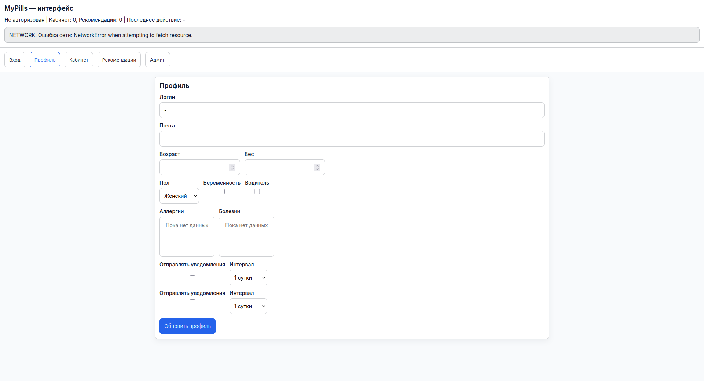
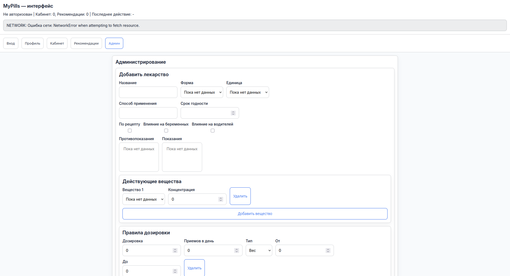

# 💊 MyPills (МайПилс)

Описание предметной области, требований и сценариев WebLab.
[Контракт OpenAPI 3.1](../openapi/v2.yaml) описывает основной API v2;
[отчёт WebLab#3](lab3-report.md) содержит реализацию и результаты проверок.
[Сгенерированная спецификация](../swagger/swagger.yaml) описывает совместимый API v1.

В целевом API у пользователя может быть несколько именованных аптечек. Профиль
доступен по `/api/v2/users/me` с токеном, а список пополнения запасов — по
`/api/v2/restock-list`. Прежний API работает под `/api/v1`.

## Цель работы

Разрабатываемый проект представляет собой систему персонализированного управления домашней
аптечкой, автоматизирующую логистический учёт препаратов и обеспечивающую их
интеллектуальный подбор. Система позволяет контролировать сроки годности, мониторить
остатки лекарств и упрощённо пополнять запасы. Алгоритм подбора по симптомам автоматически
проверяет препарат на совместимость с профилем пользователя (аллергии, противопоказания,
статус) и рассчитывает персональные дозировки.

## Краткий перечень функциональных требований 

- Пользователь может создать несколько аптечек и добавлять, изменять и удалять препараты в каждой.
- Система хранит количество и срок годности каждого препарата.
- Система показывает препараты с истекающим сроком годности и низким остатком.
- Пользователь может указать аллергии и противопоказания в своём профиле.
- Система проверяет найденные препараты на совместимость с профилем пользователя.
- Пользователь может сформировать список препаратов для пополнения запасов.

## Ключевые нефункциональные требования

### Производительность

- При нагрузке до 20 запросов в секунду 95% запросов на получение содержимого
  аптечки должны выполняться не более чем за 1 с.

### Надёжность

- После перезапуска приложения все ранее подтверждённые изменения аптечки должны
  сохраняться, а готовность системы к работе должна восстанавливаться не более чем
  за 180 секунд.

### Безопасность

- Все операции просмотра и изменения аптечки должны быть доступны только
  авторизованному владельцу; неавторизованные запросы должны в 100% случаев
  возвращать HTTP 401 или 403 и не раскрывать пользовательские данные.

## Use-case диаграмма системы

Нажмите на диаграмму, чтобы открыть её в полном размере. Исходники диаграмм
лежат в соответствующих каталогах `docs/`.

## BPMN диаграмма

## Описание основных пользовательских сценариев

### Сценарий 1: Добавление нового лекарства в аптечку
**Актор:** Пользователь.
**Цель:** Зафиксировать наличие препарата и поставить его на контроль срока годности.

1.  Пользователь выбирает свою аптечку или создаёт новую.
2.  Пользователь нажимает кнопку «Добавить» и ищет препарат по названию.
3.  Система показывает подходящие лекарства из каталога.
4.  Пользователь выбирает нужный препарат и его дозировку из результатов поиска.
5.  Пользователь указывает дату изготовления, текущее количество препарата в пачке и минимальный остаток.
6.  Система создаёт позицию в выбранной аптечке, связывая её с Пользователем и Лекарством.
7.  Препарат отображается в списке «В наличии» выбранной аптечки, статус срока годности становится активным.

---

### Сценарий 2: Подбор препарата при возникновении симптома
**Актор:** Пользователь.
**Цель:** Получить безопасную рекомендацию по приему лекарства из имеющихся запасов.

1. Пользователь выбирает актуальный симптом.
2.  Система находит все лекарства, для которых данное заболевание указано в связи «Рекомендуется».
3. Проверка безопасности:
    * Система исключает препараты, содержащие вещества, на которые у пользователя есть аллергия.
    * Система исключает препараты, которые противопоказаны пользователю.
    * Проверяется противопоказания по статусу: «Беременность» или «Вождение».
4.  Система сопоставляет список безопасных веществ с позициями всех аптечек пользователя или выбранной аптечки, фильтруя только записи, где Срок годности > Сегодня.
5.  Система запрашивает данные из таблицы Дозировка, сопоставляет их с Весом (или Возрастом) пользователя и Концентрацией в конкретной пачке.
6. Пользователь видит рекомендацию: «Примите 1 таблетку [Торговое наименование]».

---

### Сценарий 3: Регистрация и настройка профиля здоровья
**Актор:** Неавторизованный пользователь.
**Цель:** Создать цифровой медицинский профиль для безопасного подбора лекарств в будущем.

1. Пользователь открывает приложение и вводит базовые данные (имя, пароль).
2. Пользователь указывает свой Возраст и Вес (эти данные необходимы для расчета дозировок в таблице Дозировка).
3. Пользователь отмечает специфические параметры: «Наличие беременности» или «Потребность в вождении» (влияет на фильтрацию через таблицу Клиническая информация).
4. Пользователь выбирает из справочника Вещество те компоненты, на которые у него есть аллергическая реакция (запись в связующую таблицу Имеет аллергию).
5. Пользователь отмечает имеющиеся болезни из справочника Заболевание (связь Имеет заболевание).
6. В таблице Пользователь создан полный профиль, позволяющий системе проводить автоматическую проверку безопасности.

---

## ER-диаграмма сущностей

## Технологический стек

- Бэкенд: Go + Gin
- Фронтенд: TypeScript + React
- СУБД текущей реализации: PostgreSQL 16
- Механизм доставки приложения: Docker Compose

## Диаграмма БД

## Раскрытие проекта в нотации C4

### Context (L1)

Уровни Container и Component описаны в [исходной C4-модели](../c4/main.dsl).

## Экраны будущего web-приложения

## Краткие записи об архитектурных решениях

### ADR-001: Использование PostgreSQL как основной базы данных

**Статус:** принято.

**Контекст:** MyPills хранит пользователей, лекарства, вещества, заболевания,
противопоказания и содержимое аптечек. Между сущностями существует большое
количество связей, а изменения данных должны быть согласованными.

**Рассмотренные варианты:**

1. PostgreSQL — реляционная модель, транзакции и контроль целостности данных.
2. SQLite — простое развёртывание, но хуже подходит для многопользовательского
   серверного приложения.

**Решение:** использовать PostgreSQL как основное хранилище.

**Причины выбора:** предметная область имеет выраженную реляционную структуру.
Внешние ключи и транзакции позволяют контролировать корректность медицинских
справочников и пользовательских данных.

**Последствия:** изменения схемы требуют миграций. Для работы приложения необходим
отдельный экземпляр PostgreSQL.

### ADR-002: Контейнеризация приложения с помощью Docker Compose

**Статус:** принято.

**Контекст:** для работы MyPills необходимы backend, frontend и база данных.
Стенд должен воспроизводимо запускаться на разных компьютерах.

**Рассмотренные варианты:**

1. Ручной запуск каждого компонента — просто на этапе разработки, но требует
   отдельной настройки окружения.
2. Docker Compose — описывает все компоненты и их связи в одном файле.
3. Kubernetes — предоставляет развитое управление контейнерами, но избыточен для
   локального учебного проекта.

**Решение:** поставлять и запускать компоненты приложения через Docker Compose.

**Причины выбора:** Compose обеспечивает изоляцию зависимостей и воспроизводимый
запуск всего стенда одной командой.

**Последствия:** на компьютере должен быть установлен Docker. Необходимо хранить
настройки окружения отдельно от образов и не включать секреты в репозиторий.
